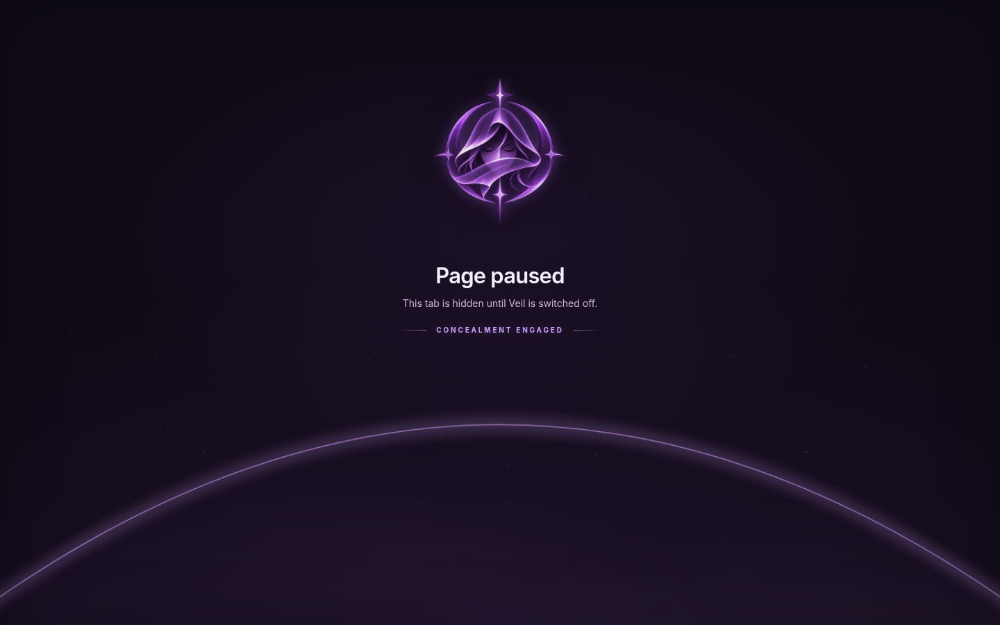
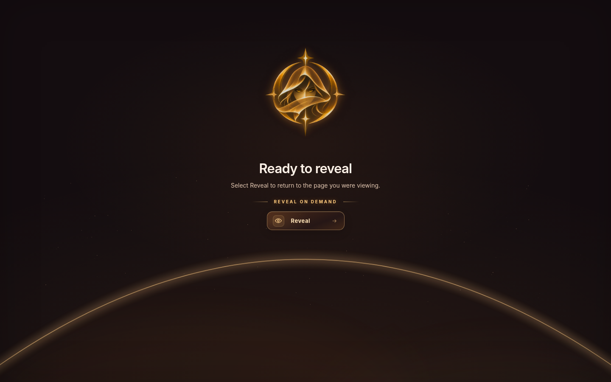
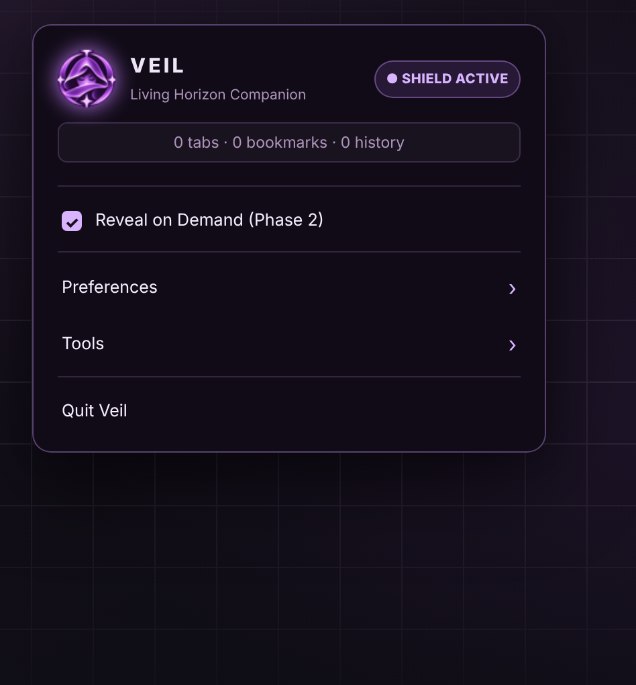
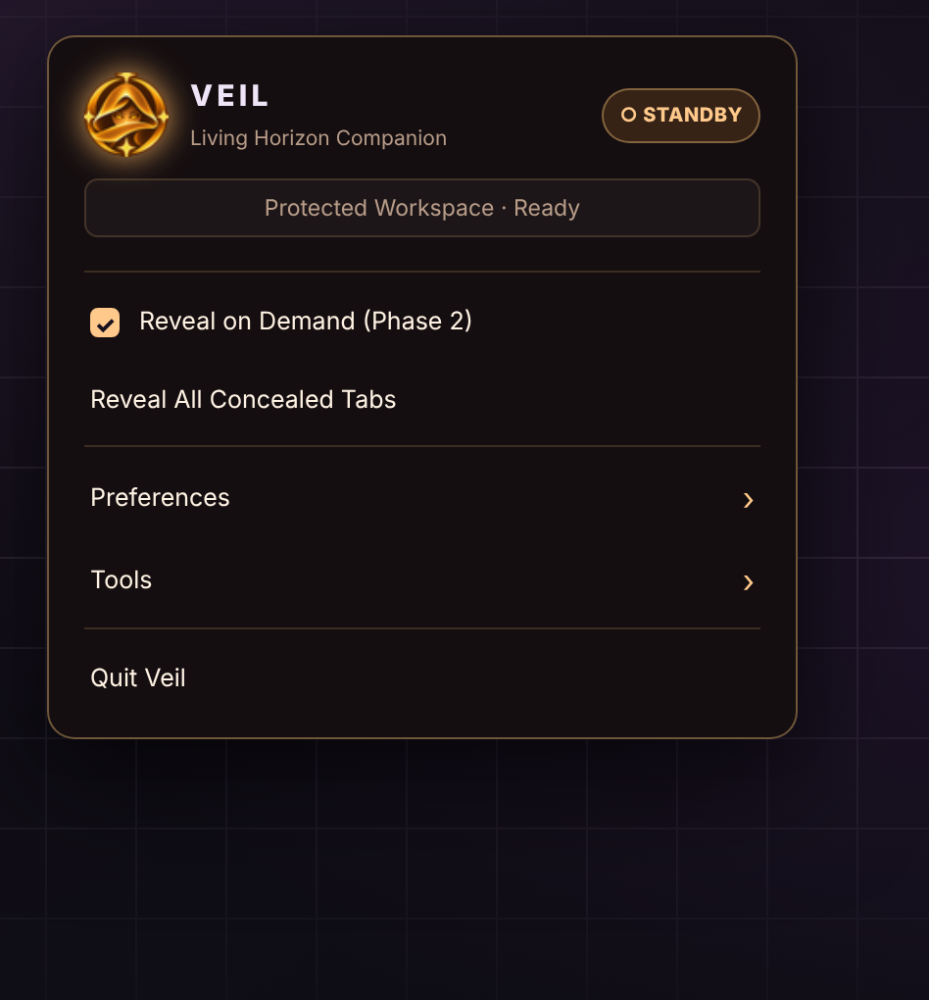
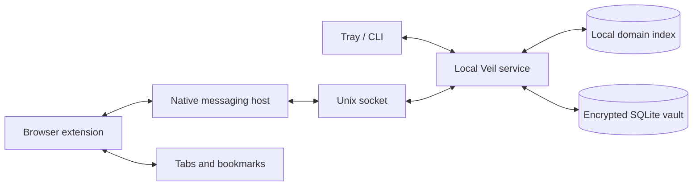
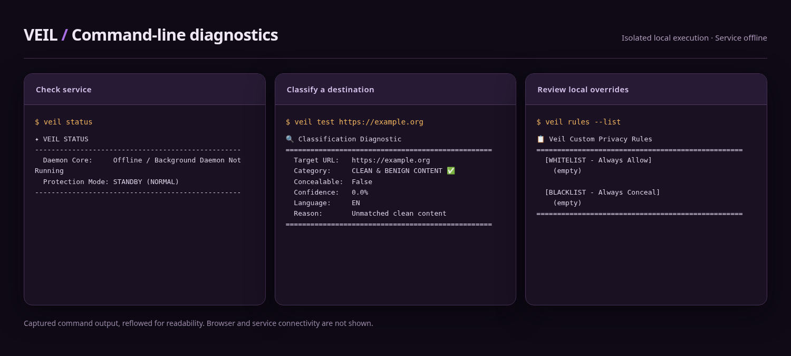

<p align="center">
  
</p>

<p align="center">
  Fast, reversible browser visibility control for Linux desktops.<br />
  Offline matching · Encrypted recovery · One-click control
</p>

<p align="center">
  <a href="https://github.com/Bluenochian/Veil/actions/workflows/ci.yml"></a>
  
  
  <a href="LICENSE"></a>
</p>

<p align="center">
  <a href="#get-started">Install</a> ·
  <a href="#pause-screens">Pause screens</a> ·
  <a href="#how-it-works">How it works</a> ·
  <a href="#limits">Limitations</a> ·
  <a href="#documentation">Docs</a> ·
  <a href="https://github.com/Bluenochian/Veil/releases/tag/v1.0">Release 1.0</a>
</p>

---

## What Veil does

Veil is a Linux desktop companion for temporarily concealing selected browser tabs and bookmarks. It matches destinations using a bundled offline domain index, URL/title checks, and local rules. Matching tabs get a pause screen; recovery records are stored in an encrypted local vault.

Switch protection off when you're ready to bring things back. Its useful for screen sharing, recording, presentations, and shared desktops.

**First-time safety:** use a disposable browser profile and export important bookmarks. Veil needs a browser extension and the desktop service running. It doesn't erase browser history, provide anonymity, or guarantee that a page won't appear briefly before an extension reacts.

### A note from the developer

You know how it goes. You need something, you go looking for it, and when you can't find what you're after, you end up making it yourself. That's how Veil started. Glad someone made it? Yeah, I wasn't as lucky as you.

I've been working on it on and off for a couple of months, alongside my day job and other projects. I was using it myself the whole time, fixing things here and there and adding whatever I felt was missing. After a few months of living with it, I figured it might be useful to other people too.

Getting a project ready to share takes more time than you'd think. In case the rather dramatic banner didn't give it away, yes, it's AI-generated. Don't judge me too hard, alright? I had some AI help tidying up parts of this README too. You can give me shit for it, just don't overdo it. Turns out making something for yourself and getting it ready for everyone else are two very different jobs. But I'm finally at a point where I feel good about putting it out there.

Most of my testing has been on Fedora, because that's what I've been using. If something breaks on another distro, I'm sorry about that. Open an issue and let me know what happened, and I'll do my best to get a fix or patch out as quickly as I can.

## Pause screens

<p align="center">
  <a href="docs/images/paused-concealed.png"></a>
  <a href="docs/images/paused-ready-to-reveal.png"></a>
</p>
<p align="center"><em>Conceal · violet / Reveal · amber</em></p>

These are screenshots of Veil's actual browser pages in a demo state, not a live extension-to-service session. [Capture details](docs/SCREENSHOTS.md).

## Tray controls

<p align="center">
  <a href="docs/images/tray-shield-active.png"></a>
  <a href="docs/images/tray-standby.png"></a>
</p>

The tray shows a **violet active mode** and an **amber standby mode**. Left-click the tray icon to toggle; right-click for **Reveal on Demand**, **Reveal All Concealed Tabs** (when inactive), **Preferences**, **Tools**, and **Quit**. The [illustrated tray manual](docs/TRAY_MENU.md) explains every item, including Camouflage Mode, audio feedback, Boss Key, Panic, clipboard cleanup, and browser rescan.

Looks clean? It better. That little tray menu has eaten more of my patience than something the size of a postage stamp has any right to.

The tray pictures are menu mockups, not Fedora desktop captures. [How they were made](docs/SCREENSHOTS.md).

[Tray menu reference](docs/TRAY_MENU.md)

## Get started

### 1. Install on Linux

Requirements: Python 3.10+, PySide6, `cryptography`, `secret-tool`, an unlocked KDE Wallet or GNOME Keyring, a graphical Wayland/X11 session, and a supported browser. The installer can offer dependency installation via the distribution package manager.

```bash
git clone https://github.com/Bluenochian/Veil.git
cd Veil
bash scripts/install.sh
```

Upgrading an older build? **Stop the Veil tray/service first and back up your vault.** The previous `veil.key` migrates to your desktop wallet on first launch. [Wallet setup](docs/INSTALLATION.md#desktop-wallet-setup-and-safe-upgrades).

Already have the dependencies installed? Use `bash scripts/install.sh --no-deps`. The per-account installation writes to `~/.local/share/veil/app/` and installs command wrappers into `~/.local/bin/`. Make sure that directory is in `PATH`.

The installer recognizes APT, DNF, Pacman, and Zypper families. [Distribution-specific installation notes](docs/INSTALLATION.md).

### 2. Connect a browser

**Brave, Chromium, Chrome, Edge, and Chromium-family browsers:** open the browser's extensions page, turn on developer mode, choose **Load unpacked**, then select the installed extension directory:

```text
~/.local/share/veil/app/browser-extension/chrome
```

**Firefox-family browsers:** open `about:debugging#/runtime/this-firefox`, choose **Load Temporary Add-on**, and select:

```text
~/.local/share/veil/app/browser-extension/firefox/manifest.json
```

Firefox temporary debug extensions disappear after a restart. A signed add-on is required for persistent Firefox distribution. Browser stores and signed packages are not part of this repository.

```bash
veil install-extension
```

This registers the native-messaging bridge for supported detected browsers. The desktop service and extension must both be available for protection to work. [Full browser setup →](docs/BROWSER_SETUP.md)

### 3. Start and verify

```bash
veil tray
```

In another terminal:

```bash
veil status
veil browsers
veil test https://example.org
```

For a controlled first test, add a temporary domain in a disposable browser profile:

```bash
veil rules --add-black example.net
veil test https://example.net
veil toggle
veil status
```

Open a matching URL in that disposable profile, confirm the local pause page, switch Veil back off, and test **Reveal**. Remove the temporary override afterwards:

```bash
veil rules --remove example.net
```

`veil status` reports the desktop service state, not whether every browser profile is connected. Check the extension in your test profile.

[Illustrated first-run guide →](docs/GETTING_STARTED.md) · [Installation and dependency guide →](docs/INSTALLATION.md)

---

## How it works

The browser extension handles presentation. The local service handles protection state, classification, and encrypted recovery records. Communication happens through the browser's native-messaging channel and a local Unix socket.



Recovery records are committed before a tab is sent to the pause screen. If that seems painfully obvious, congratulations: you got to skip the part where I learned why the opposite order is a terrible idea.

The [architecture guide](docs/ARCHITECTURE.md) has the full sequence diagrams and failure cases.

[Privacy and data flow](docs/PRIVACY.md)

## Features

| Feature | Details | Guide |
| :--- | :--- | :--- |
| **One-click protection** | Toggle from tray or terminal; the service must acknowledge changes | [Controls](docs/USING_VEIL.md#protection-controls) |
| **Two-phase pause screen** | Violet cover while active; amber Reveal action after deactivation | [Visual walkthrough](docs/GETTING_STARTED.md#4-confirm-the-two-screen-states) |
| **Per-tab recovery** | Recover a paused tab without reopening all of them at once | [Restoring tabs](docs/USING_VEIL.md#restoring-tabs) |
| **Reversible bookmarks** | Store selected bookmark records before removal, then recreate them | [Bookmarks](docs/USING_VEIL.md#bookmarks-and-recovery) |
| **Local classifier** | Bundled offline domain index, URL/title heuristics, and local overrides | [Matching](docs/USING_VEIL.md#customizing-matching) |
| **Encrypted vault** | AES-256-GCM; the live key lives in your desktop wallet, not next to the database | [Key limits](docs/PRIVACY.md#encryption) |
| **Vault backups** | Passphrase-protected `.veilvault` export and import (new backups use scrypt) | [Backups](docs/RECOVERY.md#encrypted-export) |
| **Batch handling** | Bulk storage and restoration paths designed for many tabs | [Design](docs/ARCHITECTURE.md#batch-processing) |
| **Desktop actions** | Tray, CLI, timer, panic, boss-key, autostart | [Controls](docs/USING_VEIL.md#protection-controls) |
| **Clipboard and cache tools** | Narrowly scoped sanitization and temporary-data cleanup | [Limitations](docs/PRIVACY.md#what-remains-visible) |

<details>
<summary><strong>What is scanned, and how can matching be adjusted?</strong></summary>

The local classifier combines a bundled offline adult-domain index with contexual heuristics and local matching rules. It covers several kinds of content people might not want visible in a shared workspace, such as mature media, wagering, graphic material, and selected unsafe marketplaces. False positives and missed pages remain possible, especially for research, reporting, and educational contexts. Use the allowlist and blocklist to adjust behavior without changing source files.

```bash
veil rules --list
veil rules --add-white research.example.org
veil rules --add-black private.example.org
veil rules --remove private.example.org
veil test https://research.example.org "Article title"
```

An allowlist entry means “leave this destination alone”; a blocklist entry means “match this destination”. The allowlist wins if the two overlap, so you can fix a false positive without changing the classifier. Smart, right? I know.

Test changes before enabling protection for valuable browsing sessions. [Classifier guide →](docs/USING_VEIL.md#customizing-matching)

</details>

## License

Veil's original code and project artwork are published under the [PolyForm Noncommercial License 1.0.0](LICENSE). You may study, modify, use, and share the project for permitted noncommercial purposes; commercial use requires a separate agreement with Bluenochian. Maintain the license and required copyright notice when distributing copies. Veil is **source-available**, not OSI-approved open-source software. Third-party libraries remain under their respective licenses.

The offline adult-domain index has its own [upstream license and attribution](DATA_LICENSE.md). No list guarantees complete coverage.

## Browser support

| Family | Integration path | Important limitation |
| :--- | :--- | :--- |
| Chromium family | MV3 extension in `browser-extension/chrome` | Unpacked development install; sandboxed builds may need extra bridge setup |
| Firefox family | Extension in `browser-extension/firefox` | Temporary debug add-on; signed persistent distribution not included |
| Linux desktop | PySide6 tray + local service, Wayland/X11 | Tray presence, hotkeys, notifications, and minimization vary by desktop |

Example browsers include Brave, Chromium, Google Chrome, Edge, Vivaldi, Firefox, LibreWolf, and related forks. Mentioned browsers are compatibility targets, not a claim that every edition and version has been certified. [Supported environments →](docs/COMPATIBILITY.md)

## CLI

| Command | Use |
| :--- | :--- |
| `veil tray` | Start the tray and local service |
| `veil status` | Check service state (`--json` for scripts) |
| `veil toggle` | Switch protection on or off |
| `veil reveal-all` | Restore paused tabs through connected extensions |
| `veil test https://example.org` | Check classification |
| `veil rules --list` | Show current allowlist and blocklist |
| `veil browsers` | List detected profiles |
| `veil stats` | Check vault record counts |
| `veil export backup.veilvault` | Create an encrypted backup |
| `veil install-extension` | Register native messaging |

The [CLI reference](docs/CLI.md) covers the remaining commands, including import, Panic, timers, and Boss Key.

<p align="center"></p>
<p align="center"><sub>Captured CLI output from an isolated Linux session; commands shown with the service stopped.</sub></p>

[Complete CLI reference →](docs/CLI.md) · [Recovery guide →](docs/RECOVERY.md)

## Limits

Veil hides matching tabs in participating browsers and keeps recovery data locally. It does **not** remove browser history, hide downloads or OS previews, provide network anonymity, or protect an unlocked session from privileged access. Crashes, browser sync, and extension timing may affect restoration. Keep an independent bookmark backup.

[Full privacy and threat model](docs/PRIVACY.md)

---

## Documentation

Start with the [first-run guide](docs/GETTING_STARTED.md). Then see [installation](docs/INSTALLATION.md), [browser setup](docs/BROWSER_SETUP.md), [everyday use](docs/USING_VEIL.md), [recovery](docs/RECOVERY.md), and [troubleshooting](docs/TROUBLESHOOTING.md).

For contributors: [architecture](docs/ARCHITECTURE.md), [compatibility](docs/COMPATIBILITY.md), [CLI](docs/CLI.md), [tray controls](docs/TRAY_MENU.md), [feature details](docs/FEATURES.md), and [screenshot methods](docs/SCREENSHOTS.md).

Policies: [privacy](docs/PRIVACY.md), [security reporting](SECURITY.md), [license](LICENSE), [domain data licensing](DATA_LICENSE.md), and [third-party notices](THIRD_PARTY_NOTICES.md).

## Contributing

```bash
python3 -m compileall -q veil
python3 -m pytest -q tests
node tests/browser_extension_smoke.cjs
node tests/browser_scale.cjs
bash -n scripts/install.sh scripts/uninstall.sh
```

These tests cover Python regressions and simulated browser APIs. Real browser and desktop compatability still need testing on the target system. Prebuilt native packages and signed browser-store extensions aren't shipped here.

If you know a cleaner way to make native messaging behave across browsers, please open a PR. Where were you while I was untangling those manifests? (Seriously, send the fix. Ill be delighted.)

See [CONTRIBUTING.md](CONTRIBUTING.md), [SECURITY.md](SECURITY.md), and [SUPPORT.md](SUPPORT.md).

<p align="center"><strong>VEIL</strong></p>
