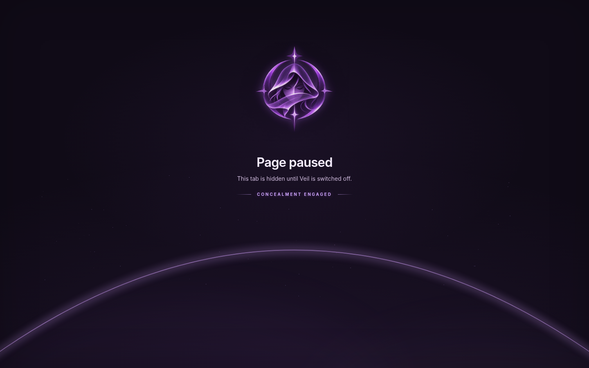
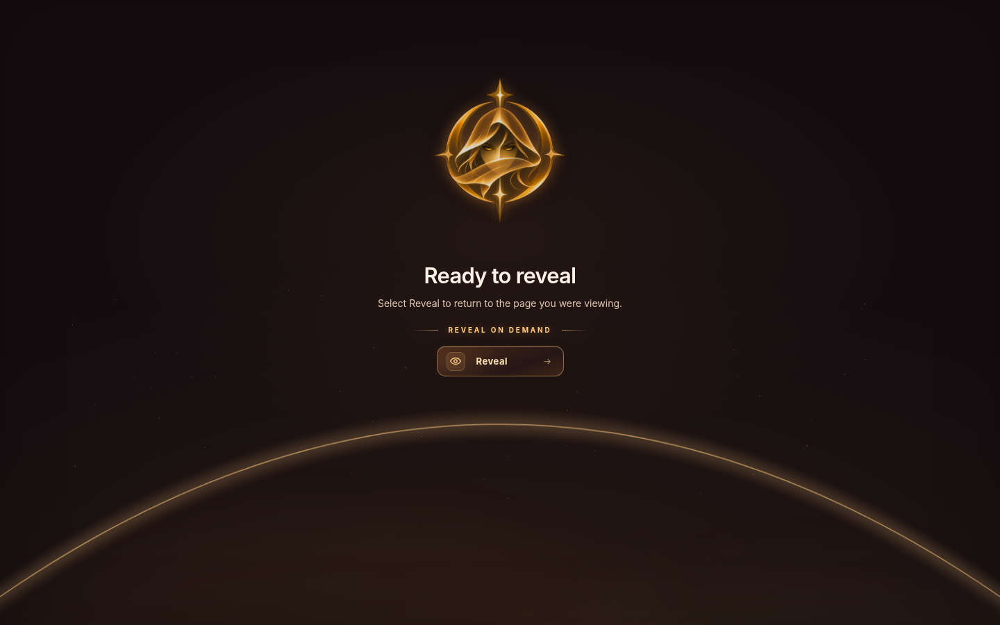
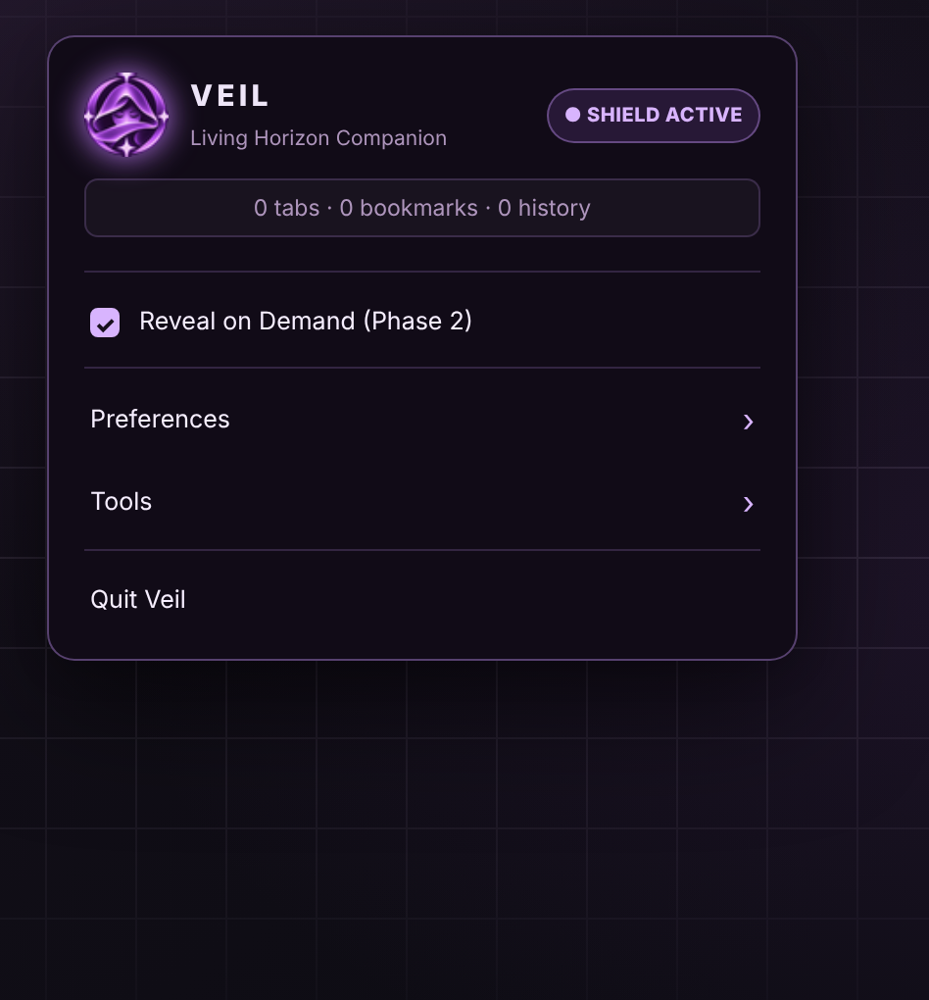
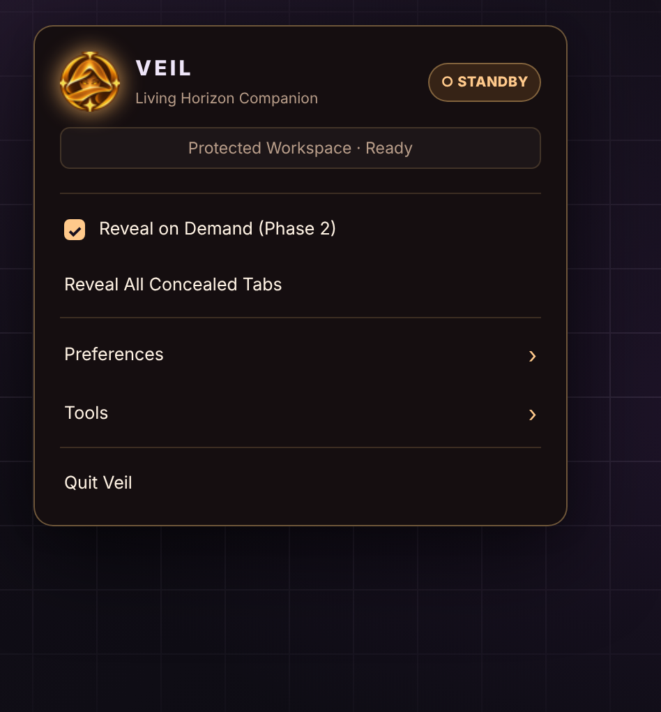
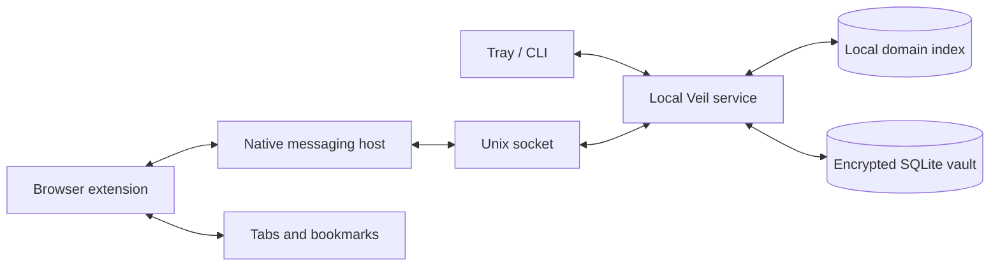

<p align="center">
  
</p>

<p align="center">
  Fast, reversible browser visibility control for Linux desktops.<br />
  Offline matching · Encrypted recovery · One-click ON / Password-protected OFF
</p>

<p align="center">
  <a href="https://github.com/Bluenochian/Veil/actions/workflows/ci.yml"></a>
  
  
  <a href="LICENSE"></a>
</p>

<p align="center">
  <a href="#get-started">Install</a> ·
  <a href="#pause-screens">Pause screens</a> ·
  <a href="#how-it-works">How it works</a> ·
  <a href="#limits">Limitations</a> ·
  <a href="#documentation">Docs</a> ·
  <a href="https://github.com/Bluenochian/Veil/releases/tag/v1.0.1">Release 1.0.1</a>
</p>

---

## What Veil does

I made Veil because I wanted a way to get some tabs and bookmarks out of sight, then bring them back without rebuilding my browser session from memory.

It runs as a Linux tray app with an extension for Chromium-based browsers or Firefox. The extension swaps matching tabs for a local pause page. It also tries to quiet video and audio on matching pages while that switch happens, so a tab doesn't suddenly start blaring. Veil keeps their original destinations in an encrypted vault on your machine. Matching uses a bundled offline domain list, URL/title checks, and rules you can change yourself.

**ON is one click. OFF needs your unlock password.** It doesn't erase browser history or make you anonymous. And the extension and desktop service both need to be running; an active tray icon by itself doesn't mean every browser is covered.

Try it in a spare browser profile first. If you have important bookmarks, export them before experimenting.

### A note from the developer

You know how it goes. You need something, you go looking for it, and when you can't find what you're after, you end up making it yourself. That's how Veil started. Glad someone made it? Yeah, I wasn't as lucky as you.

I've been working on it on and off for a couple of months, alongside my day job and other projects. I was using it myself the whole time, fixing things here and there and adding whatever I felt was missing. After a few months of living with it, I figured it might be useful to other people too.

Getting a project ready to share takes more time than you'd think. In case the rather dramatic banner didn't give it away, yes, it's AI-generated. Don't judge me too hard, alright? I had some AI help tidying up parts of this README too. You can give me shit for it, just don't overdo it. Turns out making something for yourself and getting it ready for everyone else are two very different jobs. But I'm finally at a point where I feel good about putting it out there.

Most of my testing has been on Fedora, because that's what I've been using. If something breaks on another distro, I'm sorry about that. Open an issue and let me know what happened, and I'll do my best to get a fix or patch out as quickly as I can.

## Pause screens

<p align="center">
  <a href="docs/images/paused-concealed.png"></a>
  <a href="docs/images/paused-ready-to-reveal.png"></a>
</p>
<p align="center"><em>Conceal · violet / Reveal · amber</em></p>

These are screenshots of Veil's actual browser pages in a demo state, not a live extension-to-service session. [Capture details](docs/SCREENSHOTS.md).

## Tray controls

<p align="center">
  <a href="docs/images/tray-shield-active.png"></a>
  <a href="docs/images/tray-standby.png"></a>
</p>

The tray shows a **violet active mode** and an **amber standby mode**. Left-click to protect immediately; clicking while active asks for your unlock password before Veil turns OFF. Configure or change it under **Preferences → Set / Change Unlock Password**. Right-click for **Reveal on Demand**, **Reveal All Concealed Tabs** (when inactive), **Preferences**, **Tools**, and **Quit**. The [illustrated tray manual](docs/TRAY_MENU.md) explains every item, including Camouflage Mode, audio feedback, Boss Key, Panic, clipboard cleanup, and browser rescan.

It's a bit messy but oh well... That little tray menu has eaten more of my patience than something the size of a postage stamp has any right to.

The tray pictures are menu mockups, not Fedora desktop captures. [How they were made](docs/SCREENSHOTS.md).

[Tray menu reference](docs/TRAY_MENU.md)

## Get started

You need Linux, Python 3.10+, PySide6, `cryptography`, `secret-tool`, and an unlocked KDE Wallet or GNOME Keyring. Wayland and X11 are supported targets, though desktop behavior can vary.

**Install:**

```bash
git clone https://github.com/Bluenochian/Veil.git
cd Veil
bash scripts/install.sh
```

If you already installed the dependencies, use `bash scripts/install.sh --no-deps`. Veil goes under `~/.local/share/veil/app/`, with the command in `~/.local/bin/`.

**Connect the browser:**

For Brave, Chrome, Chromium and similar browsers, open the extension page, enable Developer mode, and **Load unpacked** from:

```text
~/.local/share/veil/app/browser-extension/chrome
```

For Firefox, visit `about:debugging#/runtime/this-firefox`, choose **Load Temporary Add-on**, and point it at:

```text
~/.local/share/veil/app/browser-extension/firefox/manifest.json
```

Firefox removes temporary add-ons on restart. This repo doesn't ship signed browser-store extensions.

Register the bridge and start Veil:

```bash
veil install-extension
veil tray
```

From another terminal:

```bash
veil status
veil browsers
veil lock set
```

`veil browsers` only finds profiles. It doesn't prove the extension connected. To check the whole thing, use a spare profile and a harmless URL:

```bash
veil rules --add-black example.net
veil test https://example.net
veil toggle
```

Open `https://example.net` in that test profile. It should pause. Switch Veil OFF with your password, click **Reveal**, and confirm it returns to the original page. Clean up your rule when you're done:

```bash
veil rules --remove example.net
```

**Upgrading from an older version?** Stop the tray/service first and back up `~/.config/veil/`. If you still have an old `veil.key`, Veil moves it into the desktop wallet only after verifying it can read the same key back. Don't delete that file yourself. [Upgrade details](docs/INSTALLATION.md#desktop-wallet-setup-and-safe-upgrades).

[Installation notes](docs/INSTALLATION.md) · [Browser setup](docs/BROWSER_SETUP.md) · [Walkthrough with images](docs/GETTING_STARTED.md)

## How it works

The extension deals with browser tabs and the pause page. The Linux service handles matching, the ON/OFF state and recovery records. They communicate through native messaging and a local socket.



The important order is **save first, hide second**. The original URL needs to reach the encrypted vault before the browser navigates away from it. If saving fails, the tab shouldn't be hidden.

For the detail behind that, including the Firefox/Chromium differences, see [Architecture](docs/ARCHITECTURE.md).

## The bits you'll actually use

| Action | How |
| --- | --- |
| Switch Veil on or off | Click the tray icon or run `veil toggle` |
| Set/change the OFF password | Preferences → Set / Change Unlock Password, or `veil lock set` |
| Restore one tab | Click **Reveal** in its paused page, after switching OFF |
| Restore remaining tabs | **Reveal All Concealed Tabs** or `veil reveal-all` |
| Check a URL | `veil test https://example.net` |
| Change what gets matched | `veil rules --list`, `--add-white`, `--add-black`, `--remove` |
| Check the local vault | `veil stats` |
| Export an encrypted backup | `veil export backup.veilvault` |

The local allowlist takes priority over the blocklist. False matches happen, especially for research and news pages; that's why the overrides are there. The included domain database has its [own data license](DATA_LICENSE.md).

## Limits

Veil can't hide history, downloads, screenshots, previews from your OS or tabs in a browser profile that isn't connected. A page can appear briefly before the extension reacts. It also can't protect against someone who already controls your unlocked desktop session.

Restoration depends on the browser and its saved data. Browser crashes, sync conflicts and deleted bookmark folders can still cause trouble. Please keep an ordinary bookmark backup, not just a Veil vault backup. The [recovery guide](docs/RECOVERY.md) is there if something goes wrong.

Most of my testing has been on Fedora. The Python tests and browser simulations are useful, but they're not the same as running every Linux desktop and browser myself. [Compatibility notes](docs/COMPATIBILITY.md) explain the gaps.

## Documentation

If you're setting it up: [Getting started](docs/GETTING_STARTED.md), [Browser setup](docs/BROWSER_SETUP.md), [Installation](docs/INSTALLATION.md), [Using Veil](docs/USING_VEIL.md), [Tray controls](docs/TRAY_MENU.md), [CLI](docs/CLI.md).

If something broke: [Troubleshooting](docs/TROUBLESHOOTING.md), [Recovery](docs/RECOVERY.md), [Privacy](docs/PRIVACY.md).

If you're looking under the hood: [Architecture](docs/ARCHITECTURE.md), [Features](docs/FEATURES.md), [Screenshot methods](docs/SCREENSHOTS.md), [Contributing](CONTRIBUTING.md) and [Security reporting](SECURITY.md).

## License

The original Veil code and artwork use [PolyForm Noncommercial 1.0.0](LICENSE). You can use, study, modify and share them for permitted **noncommercial** purposes; commercial use needs a separate agreement. Veil is source-available, not an OSI open-source project. See [DATA_LICENSE.md](DATA_LICENSE.md) for the bundled domain index and [THIRD_PARTY_NOTICES.md](THIRD_PARTY_NOTICES.md) for dependencies.

## Contributing

If you've found a problem or have a fix, open an issue or PR. Please don't upload actual browser history, private URLs or vault files with your bug report.

```bash
python3 -m pytest -q tests
node tests/browser_extension_smoke.cjs
node tests/browser_scale.cjs
```

Real browser testing still matters, especially on desktops other than Fedora. [CONTRIBUTING.md](CONTRIBUTING.md) has setup notes.
