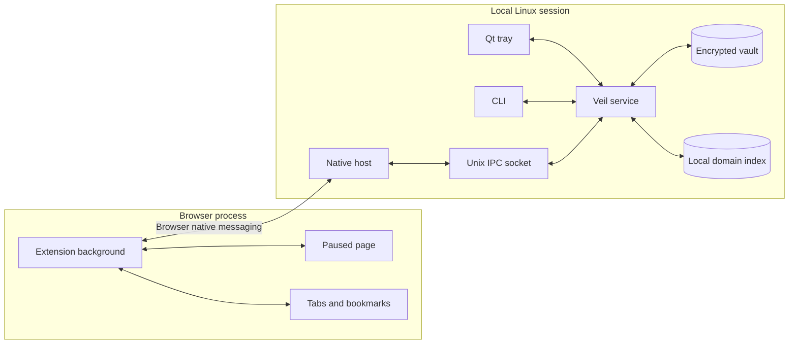
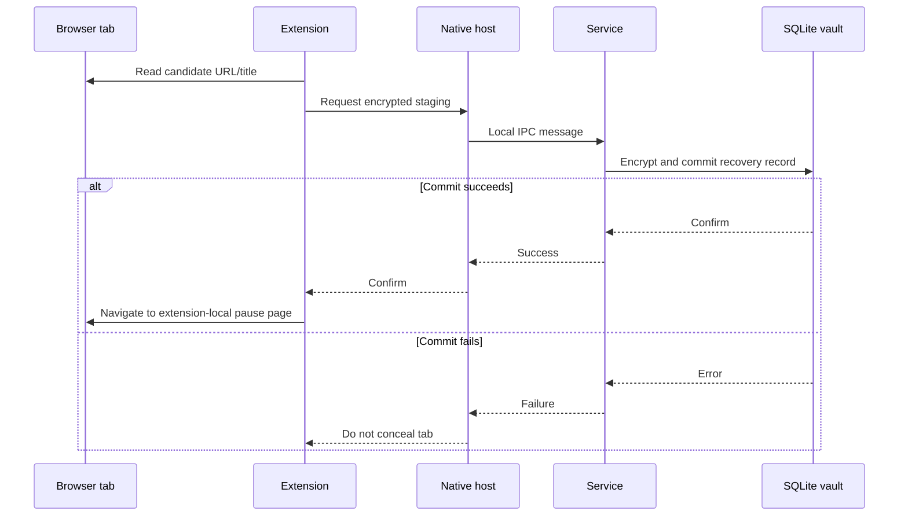
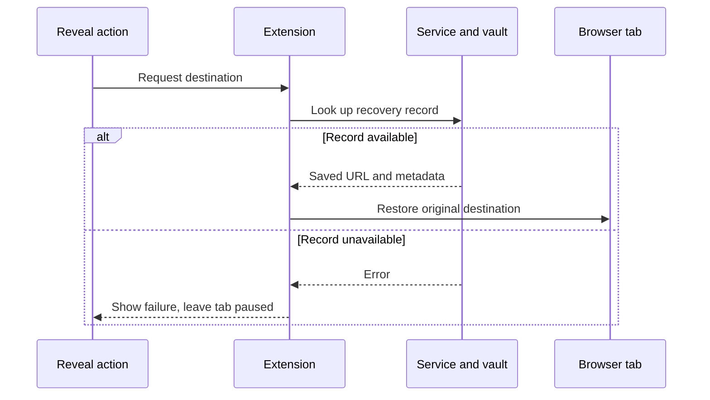

# Architecture and data flow

[← Back to Veil](../README.md) · [Using Veil](USING_VEIL.md) · [Privacy](PRIVACY.md) · [Recovery](RECOVERY.md)

Veil separates **desktop state and encrypted persistence** from **browser presentation**. That separation allows a native Linux service to retain recovery information while lightweight browser extensions handle tab navigation and paused-page UI.

## System map

### Implementation map

| Component | Implementation | Responsibility |
| --- | --- | --- |
| CLI | `veil/command.py`, `veil/cli.py` | Human and script entry points, state validation, diagnostics |
| Desktop service | `veil/service.py` | Central protection state and browser operation dispatch |
| Unix IPC | `veil/ipc_server.py` | Local requests, permission boundaries, client handling |
| Native host | `veil/native_host/` | Relay between supported browser protocols and the Unix socket |
| Classification | `veil/classifier/engine.py` | Domain lookup, URL/title analysis, local overrides |
| Encrypted vault | `veil/vault.py`, `veil/crypto.py` | AES-256-GCM record storage and encrypted export/import |
| Browser discovery | `veil/browsers/` | Local browser/profile detection |
| Desktop GUI | `veil/tray.py` | Qt tray and controls |
| Chromium extension | `browser-extension/chrome/` | MV3 tab and bookmark events, placeholder page |
| Firefox extension | `browser-extension/firefox/` | Firefox-compatible browser integration |
| Resource mapping | `veil/paths.py` | Source versus installed wheel paths |

## Concealment: persistence before navigation

The storage-first invariant matters: removing the visible destination before saving recovery data risks losing the ability to restore it. Browser APIs and page-load timing can still create gaps between navigation and concealment.

## Restoration: one tab or a batch

A restore-all request applies to connected browser contexts; it cannot guarantee restoration in closed browsers, missing profiles, or unsupported extension states.

## State model

```mermaid
stateDiagram-v2
    accTitle: Protection state lifecycle
    accDescr: When the service is absent Veil is not actively protecting. When available it may be normal or protected; matched tabs transition through paused and ready-to-reveal states.
    [*] --> Offline
    Offline --> Standby: Start service
    Standby --> Active: Toggle ON acknowledged
    Active --> Standby: Toggle OFF acknowledged
    Standby --> Offline: Stop service
    Active --> Offline: Service stopped
```

Persisted preferences aren't proof of enforcement. `veil status --json` distinguishes daemon responsiveness from saved state. Browser presentation can lag the service state, so a UI inspection remains necessary for end-to-end verification.

## Batch processing

Multiple matching tabs can be staged using bulk database transactions and fewer native-message round trips. This avoids multiplying IPC overhead by the full number of tabs. It does **not** eliminate disk encryption, browser navigation, extension event processing, or tab rendering cost.

The repository's browser scale simulations exercise 100, 250, and 1,000-tab scenarios and the Python suite includes concurrency/regression coverage. Those results are for simulated browser APIs, not a certified performance SLA for a desktop installation.

## Storage and configuration

| Location | Contents |
| --- | --- |
| `~/.config/veil/vault.db` | Local encrypted recovery store |
| `~/.config/veil/rules.json` | Local domain override configuration |
| `~/.local/share/veil/app/` | Per-account application copy |
| `~/.local/bin/veil` | CLI launcher |
| `~/.local/bin/veil-native-host` | Native-messaging launcher |
| `~/.config/autostart/veil.desktop` | Session autostart entry |
| `~/.config/systemd/user/veil.service` | Optional user service file |

The archive export format is a separate encrypted `.veilvault` file. It should be protected and stored independently. See [Recovery](RECOVERY.md).

## Threat boundaries

Native messaging receives browser-origin data and should be treated as untrusted input. The local socket and vault protect against casual access, but they don't prevent a privileged process or a compromised unlocked session from reading browser state. History, downloads, screen sharing, and OS-level previews aren't within the protection contract.

[Full privacy model →](PRIVACY.md) · [Reporting security issues →](../SECURITY.md)

## Installed resources

The standalone installer copies the browser sources and artwork into the per-account app directory. Wheel builds package equivalent resources within the Python distribution; `veil/paths.py` resolves them appropriately. A Python wheel by itself does not install the extension into a browser or register a native host.
