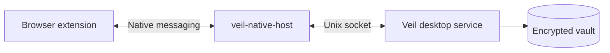
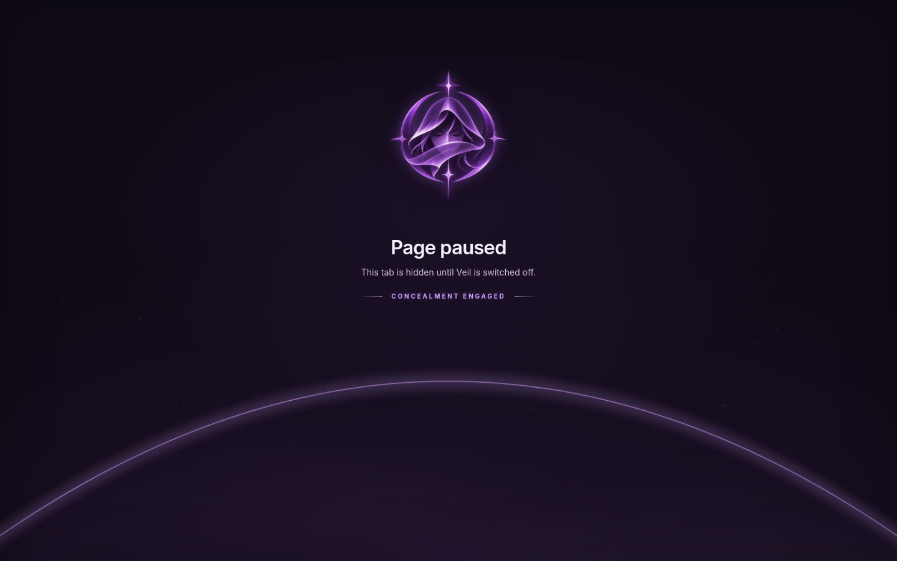

# Browser extensions and native messaging

[← Back to Veil](../README.md) · [Quick start](GETTING_STARTED.md) · [Troubleshooting](TROUBLESHOOTING.md)

Veil uses a browser extension to change tab presentation and a local desktop service to track protection state and encrypt recovery records. Loading an extension alone is not enough: **native messaging must connect the browser to the local host.**

## The connection path



## Chromium-family browsers

Examples include Brave, Chromium, Google Chrome, Microsoft Edge, Vivaldi, and other browsers that support compatible extension APIs and native messaging.

1. Open the browser's extension-management page. For Brave, use `brave://extensions`; for Chromium and Chrome, use `chrome://extensions`.
2. Turn **Developer mode** on.
3. Choose **Load unpacked**.
4. Select `~/.local/share/veil/app/browser-extension/chrome` (or `browser-extension/chrome` when testing from a source checkout).
5. Check that the extension appears and is enabled.
6. Start the desktop service and register the bridge:

```bash
veil tray
# In a second terminal:
veil install-extension
veil status
```

Browser versions and the exact location of extension controls vary. Loading an unpacked development extension does not mean it has been reviewed or signed by a browser store.

## Firefox-family browsers

Firefox's developer flow is different:

1. Open `about:debugging#/runtime/this-firefox`.
2. Choose **Load Temporary Add-on**.
3. Select `~/.local/share/veil/app/browser-extension/firefox/manifest.json`.
4. Verify that the temporary add-on appears.
5. Start the desktop service and run `veil install-extension`.

> [!IMPORTANT]
> Debugging-loaded Firefox extensions are temporary. They disappear after browser restart. Persistent installation requires a signed package distributed through an accepted Firefox add-on path; this source checkout does not include one.

The extensions share most of their tab and page logic. The difference is how they start: Chromium uses a service worker, while Firefox runs a background event page with the Promise-based `browser` API. The page styling is shared on purpose.

## Verify the link, not just the files

```bash
veil browsers
veil status
veil test https://example.org
```

These commands test profile discovery, desktop state, and classifier behavior respectively. They don't themselves prove the browser connected. Perform the [controlled conceal/reveal test](GETTING_STARTED.md#5-run-a-reversible-demonstration) in a disposable profile to confirm communication.

### What successful presentation looks like

| Protection ON | Protection OFF, tab waiting to restore |
| --- | --- |
|  |  |

The images show the actual extension page rendered with simulated local state. They aren't captures of the full native-host handshake. [Capture provenance →](SCREENSHOTS.md)

## When the extension cannot reach the desktop

| Symptom | What to check |
| --- | --- |
| Extension loads, nothing happens | Start `veil tray`; confirm `veil status` reports the service active |
| `veil browsers` sees the profile, but no tab changes | Run `veil install-extension` after the profile exists; inspect the extension background console |
| Browser reports native host not found | Check manifest registration path and that `veil-native-host` exists and is executable |
| Works in one browser but not another | Confirm each browser reads the expected native-messaging manifest location |
| Browser is installed through Flatpak or Snap | Sandbox isolation and native-host mapping may require manual support |
| Firefox extension disappears | It was a temporary debug install; use a signed release for persistence |
| Tabs paused but restoration fails | Preserve the vault; follow [Recovery](RECOVERY.md) before repeating state changes |

## Browser permissions

The extension requests tab, bookmark, local storage, and native-messaging capabilities because its operations require browser metadata access and interaction with the local service. Its internal paused page isn't listed as a web-accessible resource, so websites can't normally load it directly. The page is opened by Veil through the browser tab API. We still need to verify this behavior in real Chrome-family and Firefox installations.

There is no separate autoplay-blocking content script installed. Veil's active feature is tab/bookmark concealment and restoration, not an across-the-web autoplay blocker. Review the per-browser `manifest.json` files for exact permissions and restrictions.

## Profiles and privacy scope

Different browser profiles are separate extension installations. Veil cannot promise to cover an inactive or unconfigured profile. Browser history, downloads, other extensions, and OS-level previews are outside the visibility-control scope. [Privacy details →](PRIVACY.md)
