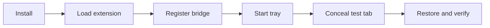
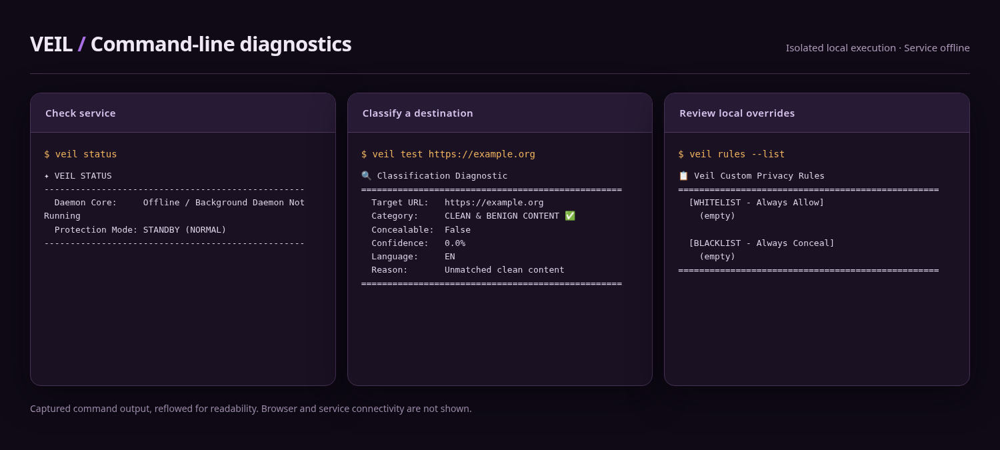
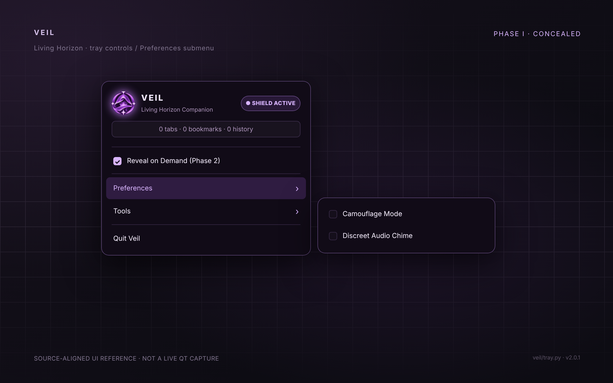
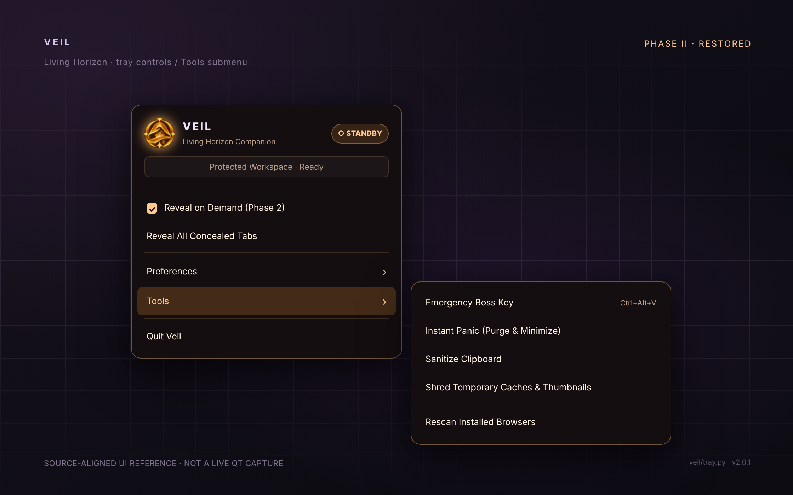
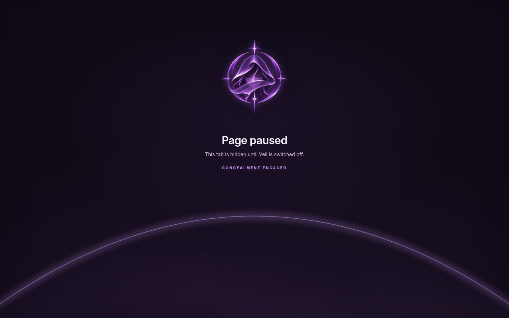

# Getting started with Veil

[← Back to Veil](../README.md) · [Installation](INSTALLATION.md) · [Browser setup](BROWSER_SETUP.md) · [Recovery](RECOVERY.md)

This illustrated guide walks through a first installation and a reversible test. Use a **separate, disposable browser profile** until you've confirmed that the extension and desktop service communicate correctly.

## At a glance



## 1. Install the desktop application

```bash
git clone https://github.com/Bluenochian/Veil.git
cd Veil
bash scripts/install.sh
```

The installer copies Veil into the account's local application directory, registers command wrappers, and prepares desktop startup. It may offer to install required system dependencies. If the dependencies are already available, use `bash scripts/install.sh --no-deps`.

Check that the command is on your path:

```bash
veil --help
```

If the shell says `command not found`, either start a new shell or temporarily add:

```bash
export PATH="$HOME/.local/bin:$PATH"
```

See [Installation](INSTALLATION.md) for distribution-family commands and supported environments.

## 2. Connect the browser

| Chromium-family browser | Firefox-family browser |
| --- | --- |
| Open the extensions page (`chrome://extensions`, `brave://extensions`, or equivalent). | Open `about:debugging#/runtime/this-firefox`. |
| Enable Developer mode and choose **Load unpacked**. | Choose **Load Temporary Add-on**. |
| Select `~/.local/share/veil/app/browser-extension/chrome`. | Select `~/.local/share/veil/app/browser-extension/firefox/manifest.json`. |

Next, register the native host from a terminal:

```bash
veil install-extension
veil browsers
```

**Why two components?** The extension can alter a browser tab, while the local desktop service maintains protection state and encrypted recovery records. Neither part replaces the other.

> [!NOTE]
> The Firefox add-on loaded through debugging is **temporary** and will be removed when Firefox restarts. Persistent distribution needs a signed extension. Flatpak, Snap, and other sandboxed browser editions may need additional native-host integration.

[Browser-specific setup and checks →](BROWSER_SETUP.md)

## 3. Start Veil and inspect its state

In a terminal:

```bash
veil tray
```

Open a second terminal:

```bash
veil status
veil browsers
veil test https://example.org
```

The first command reports desktop service status; the second lists browser profiles Veil can detect; the third checks a harmless example destination against the local classifier.



*Captured command output from an isolated Linux session, arranged for readability; the service was intentionally offline.*

Don't treat `veil browsers` as a connection test: a detected profile may not have a functioning extension/native-host connection. The visible transition in the next step is the useful end-to-end check.

## 3A. Find your way around the tray

<p align="center">
  <a href="images/tray-preferences.png"></a>
  <a href="images/tray-tools.png"></a>
</p>

Right-click the Veil tray icon to see its mode and options. **Preferences** changes the tray disguise and sound. **Tools** includes Boss Key, Panic, clipboard cleanup, temporary-cache cleanup, and browser rescan. These are tray mockups based on the code, not native Qt screenshots. [Every menu item explained →](TRAY_MENU.md)

Left-click the tray icon to toggle protection; you don't need to find an ON/OFF action inside the popup. When OFF, **Reveal All Concealed Tabs** appears. If you only want to restore one tab, use that tab's **Reveal** button.

## 4. Confirm the two screen states

### Phase one: Conceal / violet

<p align="center">
  
</p>

The local placeholder replaces a matched tab while protection is active. The page uses Veil's violet emblem and shows **Page paused** and **Concealment engaged**.

### Phase two: Reveal / amber

<p align="center">
  
</p>

After protection is switched off, a paused tab can show **Ready to reveal** with a **Reveal** button. Selecting it asks the extension to navigate back to that tab's stored destination. A missing recovery record or a disconnected extension can prevent restoration.

> [!NOTE]
> These screenshots were captured from the project's own browser placeholder in headless Chromium with the extension storage state simulated. They show the actual page design but not a real connected-browser acceptance test. [Capture details →](SCREENSHOTS.md)

## 5. Run a reversible demonstration

With a disposable browser profile open and the Veil service running:

```bash
veil rules --add-black example.net
veil test https://example.net
veil toggle
veil status
```

1. In the disposable profile, open `https://example.net` and confirm a matching tab displays Veil's pause page.
2. Turn protection off again using the tray or `veil toggle`.
3. On the paused tab, select **Reveal** and confirm the original page returns.
4. Run `veil stats` and check for unexpected retained records.
5. Remove the temporary match:

```bash
veil rules --remove example.net
```

If the tab doesn't pause, or Reveal fails, **do not keep toggling blindly**. Check the [browser bridge troubleshooting](BROWSER_SETUP.md#when-the-extension-cannot-reach-the-desktop) and [recovery steps](RECOVERY.md).

## 6. Use it for real work

| Task | Where to go |
| --- | --- |
| Toggle quickly or use a timer | [Tray controls and preferences](TRAY_MENU.md) |
| Adjust matching | [Local overrides](USING_VEIL.md#customizing-matching) |
| Understand saved bookmarks | [Bookmark behavior](USING_VEIL.md#bookmarks-and-recovery) |
| Create a backup | [Encrypted export](RECOVERY.md#encrypted-export) |
| Diagnose missing tabs | [Troubleshooting](TROUBLESHOOTING.md) |

**Before relying on Veil with important bookmarks:** make an independent browser bookmark export. Veil is a visibility-control companion, not a substitute for ordinary backups or a separate private browser profile.

> [!NOTE]
> Veil includes its offline adult-domain index automatically; no separate list download or manual database setup is needed. See [data licensing](../DATA_LICENSE.md).
