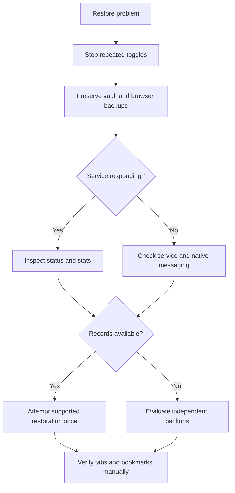

# Backups and recovery

[← Back to Veil](../README.md) · [Using Veil](USING_VEIL.md) · [Privacy](PRIVACY.md)

Veil keeps selected restoration metadata in an encrypted local vault. The goal is to make ordinary concealment reversible, but no browser extension can guarantee perfect recovery across browser crashes, profile migrations, bookmark sync conflicts, and concurrent edits.

> [!CAUTION]
> If tabs or bookmarks fail to return, **do not repeatedly toggle protection or delete the vault**. Preserve the current database and any independent bookmark export first. Restoring data into a changed browser profile may create duplicates or fail to recreate original folder positions.

## Before a problem happens

1. Export important bookmarks using your browser's own bookmark manager.
2. Verify a disposable-profile conceal/reveal cycle.
3. Export a Veil vault backup when the vault contains records you would need to recover.
4. Store backups off the active profile and retain the passphrase in a separate safe place.
5. Learn the service state with `veil status` and `veil stats`.

## Encrypted export

```bash
veil stats
veil export ~/veil-backup.veilvault
```

The export asks for a passphrase in interactive use. New backups require **at least 16 characters**; a long, unique passphrase matters more than clever punctuation. New `.veilvault` exports use scrypt (64 MiB, N=2^16, r=8, p=2) and AES-256-GCM. Older backups with the original PBKDF2 protection can still be imported, including ones created with short passphrases. If you have an old backup, make a fresh one with a strong passphrase after confirming you can restore it. Keep the archive and its passphrase separately.

> [!NOTE]
> An encrypted Veil backup protects stored vault records, not every tab, browser-history record, download, or profile setting. Keep an ordinary browser bookmark export as a second recovery path.

## Interrupted session checklist



### 1. Preserve existing state

Stop Veil and preserve `~/.config/veil/` (including `vault.db`) before manual intervention. Current versions store the **live AES key in KDE Wallet or GNOME Keyring**, not next to the database; a filesystem copy alone may not be decryptable on another computer. Preserve any legacy `veil.key` before an upgrade and keep a verified passphrase-encrypted `.veilvault` export for recovery across machines. Preserve related SQLite journal files if present. Never upload the database, key or wallet contents to a public issue.

### 2. Inspect

```bash
veil status
veil stats
veil browsers
```

Check for a running service, recognizable browser profiles, and retained vault counts. A browser profile appearing in discovery doesn't prove that the extension can reach the native messaging host.

### 3. Attempt supported recovery

If the desktop service is reachable and the extension remains loaded, restore through the normal tray controls or use `veil reveal-all` as appropriate. For tabs displaying amber **Ready to reveal**, select **Reveal** and confirm the destination actually loads.

### 4. Recover bookmarks carefully

Review browser bookmark folders and sync state. Folder deletion and concurrent changes can block exact recreation. Compare against the independent bookmark export and avoid importing duplicate copies unless necessary.

## Importing a `.veilvault` backup

First stop the desktop service. Then:

```bash
veil import ~/veil-backup.veilvault
```

The command prompts for the decryption passphrase. The import is not intended to overwrite overlapping active records. Conflicting entries can cause the import to be refused. Preserve both the existing vault and backup until you've verified recovery.

## Desktop wallet and migration problems

- **Before upgrading:** stop all older Veil trays and services. Preserve the existing `~/.config/veil/` directory and make an independent `.veilvault` export if possible.
- **Migration:** after the wallet accepts and returns the original AES key, Veil removes the old plaintext `veil.key`. The database does not get re-encrypted.
- **Wallet locked or missing:** unlock KDE Wallet/GNOME Keyring in your graphical session, install `secret-tool` if necessary and relaunch Veil. A failed migration keeps the old key file.
- **Wallet/key conflict:** don't erase either entry. Preserve both for recovery; Veil intentionally refuses to guess which key is correct.
- **Wallet entry lost:** Veil will not generate a new key for an existing database. Restore the original wallet entry, or recover from an independent passphrase-encrypted `.veilvault` backup. Simply copying the database is insufficient.
- Removing the old plaintext file does not guarantee erasure from snapshots, drive blocks or backups. Disk encryption remains important.

## Lost passphrase

A passphrase-protected archive requires the corresponding passphrase. Veil is not a hosted account and there is no server-side password recovery. An independent ordinary browser backup may be the only available fallback.

## What an archive cannot restore

The vault does not reconstruct everything a browser does. Ordinary browsing history and visit timestamps, caches, downloads, tab scroll position, logged-in sessions, other extensions' data, and unrelated desktop state are outside the reliable restoration guarantee.

## Safe incident reporting

When asking for help, provide the Linux distribution **family**, Python version, browser family/version, Veil command, and redacted error text. Don't share real URLs, vault files, native-host tokens, passphrases, browser profile archives, or private history in public reports.

[Troubleshooting →](TROUBLESHOOTING.md) · [Security reporting →](../SECURITY.md)
