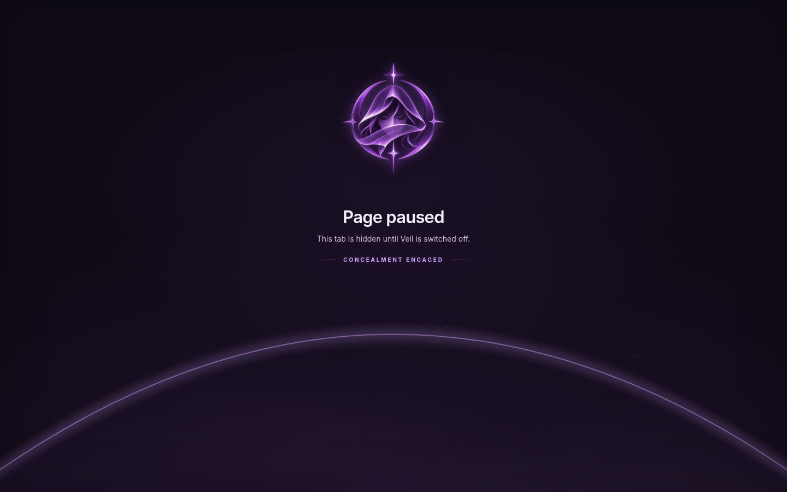
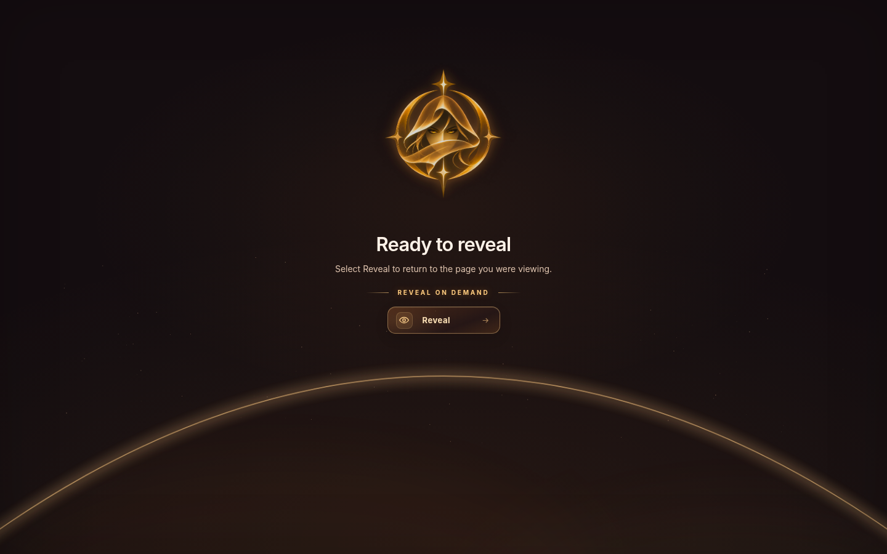
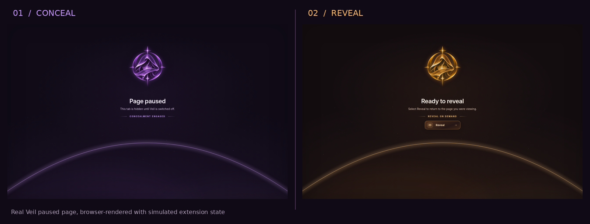
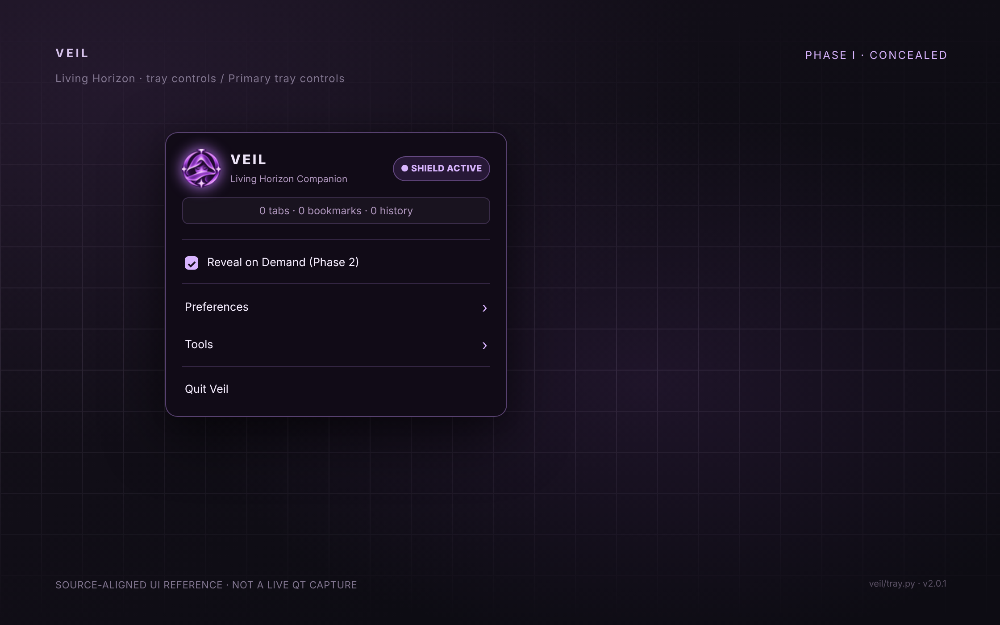
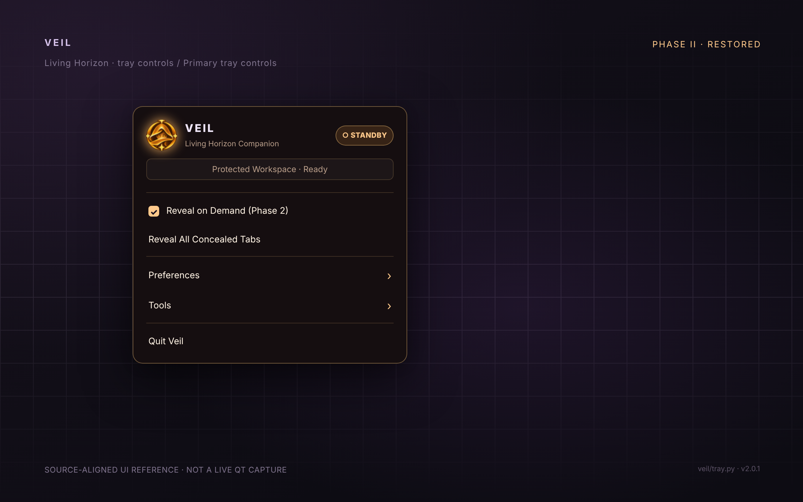
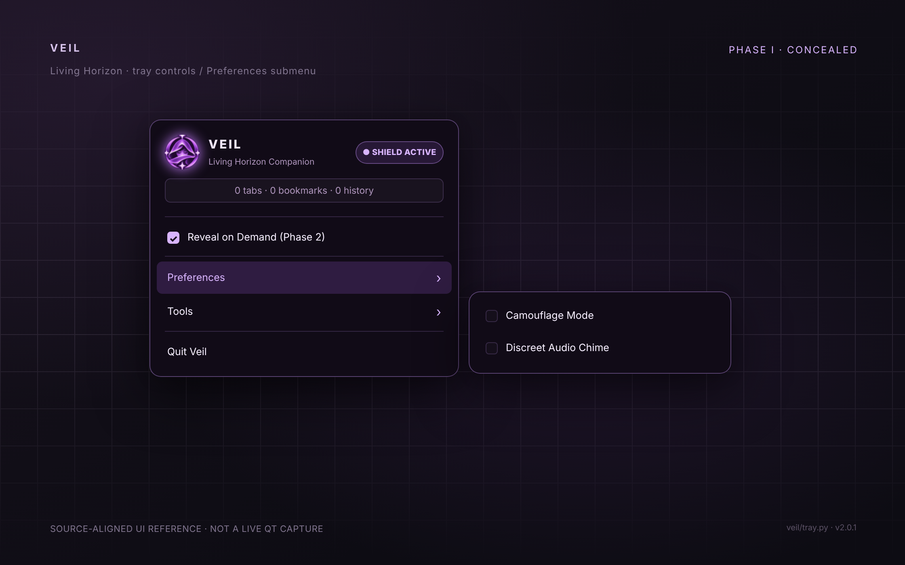
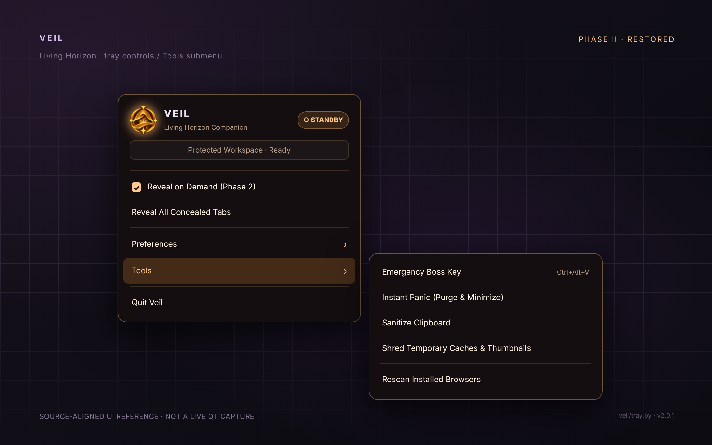
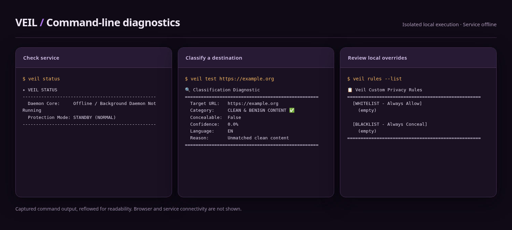

# Screenshots and visual states

[← Back to Veil](../README.md) · [Illustrated quick start](GETTING_STARTED.md)

The two browser states below are captured from the shipped extension's **actual HTML, CSS, JavaScript, and icon assets**.

## Concealment engaged

When protection is active, a matching tab can display the local **Page paused** placeholder. Violet coloring and the closed-eye emblem identify this state.

## Ready to reveal

After protection is disabled, a paused tab can display **Ready to reveal**. The Reveal control requests the original destination from extension-managed recovery state.

## Side-by-side

## Living Horizon tray menu reference views

The four tray images below are **reference mockups, not screenshots of a running Qt desktop**. They use the shipped icons and menu labels checked against `veil/tray.py`, including the conditional **Reveal All Concealed Tabs** item. Actual tray menus depend on your desktop and theme.

### Protection active / violet

### Standby / amber

### Preferences submenu

### Tools submenu

[Every control explained in the tray guide →](TRAY_MENU.md)

## CLI diagnostics

This card uses CLI output captured in an isolated Linux run. It doesn't show a connected browser or native desktop tray.

## Capture details and limits

- **Source:** `browser-extension/chrome/paused.html`, `paused.css`, `paused.js` and the shipped `icons/` assets.
- **Capture:** Chromium headless, 1440 × 900, with local extension storage simulated to show ON and OFF states.
- **Not demonstrated:** A real browser extension installation, a native-host handshake, a live Qt tray, full bookmark restoration, or behavior across multiple Linux desktops.
- **Why simulated state:** An extension-local page relies on browser extension APIs unavailable to a standalone screenshot renderer; the HTML and application graphics are not redrawn or fabricated.

For an end-to-end acceptance test, use a disposable browser profile and follow the [first-run checklist](GETTING_STARTED.md#5-run-a-reversible-demonstration).
