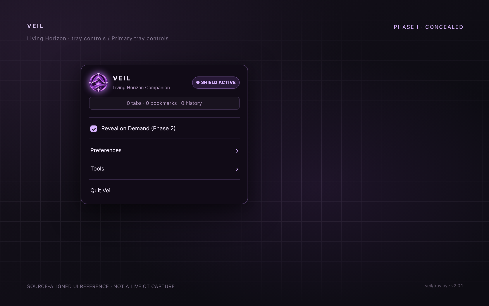
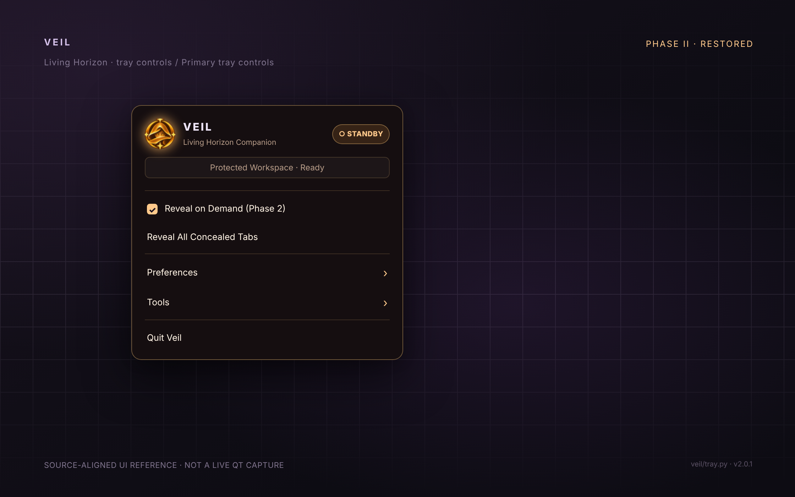
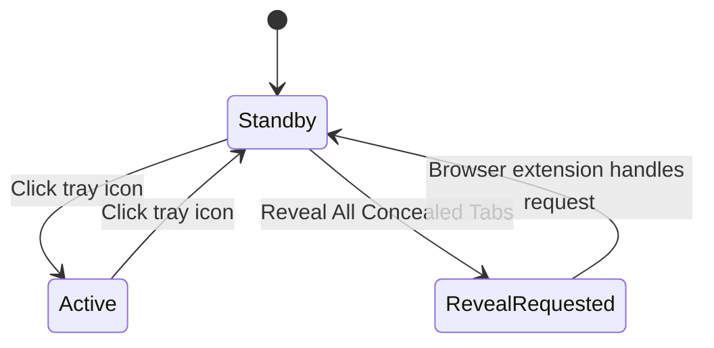
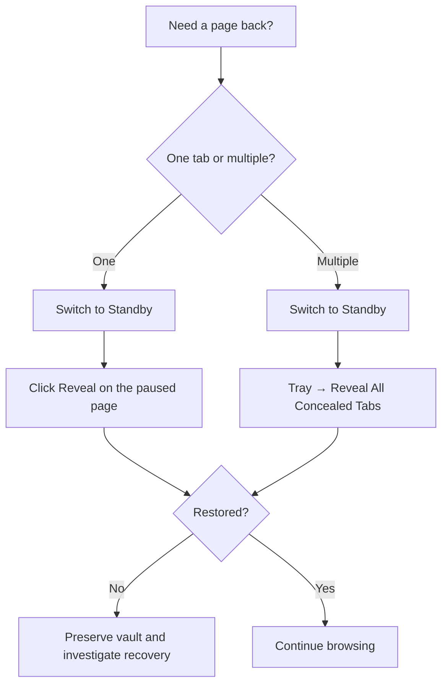
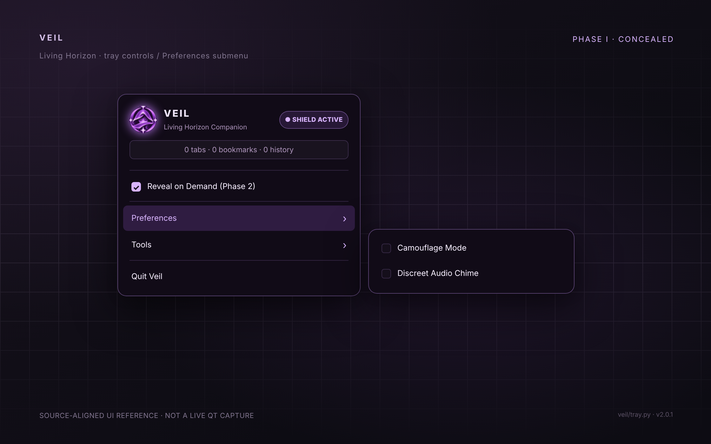
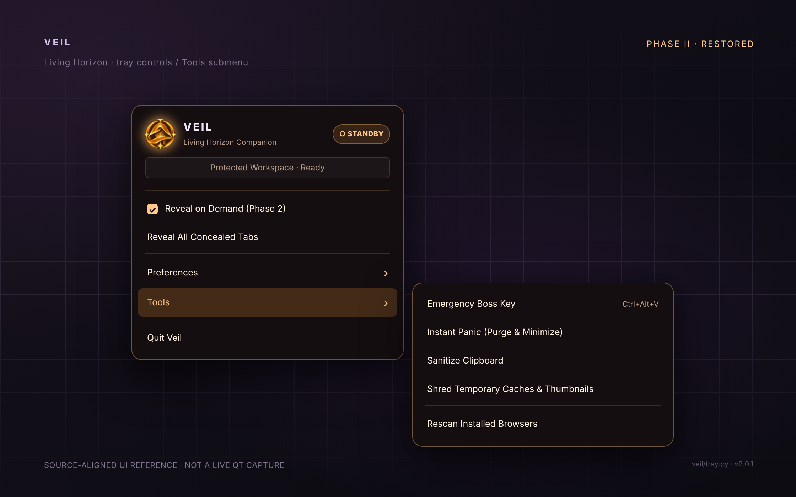

# Tray menu

[← Veil README](../README.md) · [First run](GETTING_STARTED.md) · [Browser setup](BROWSER_SETUP.md) · [Recovery](RECOVERY.md) · [CLI](CLI.md)

Left-click the tray icon to toggle Veil. Right-click to open the other controls. Violet means protection is on; amber means standby.

These tray images are mockups made from the labels and icons in [`veil/tray.py`](../veil/tray.py), not captures of a running Qt menu. Your desktop may render them differently. The [pause screens](SCREENSHOTS.md) were captured from the extension UI.

## At a glance

  
  

| When you see… | What it means | What to do |
| :--- | :--- | :--- |
| **● SHIELD ACTIVE** · violet | The local service reports protection is on. Matching participating tabs may show the paused page. | Single-click the tray icon to deactivate. |
| **○ STANDBY** · amber | The local service reports protection is off. Previously paused tabs may still show a **Ready to reveal** placeholder. | Single-click the tray icon to activate. Use **Reveal** in a paused tab, or **Reveal All Concealed Tabs** from this menu. |
| **N tabs · N bookmarks · N history** | Counters obtained from the local vault; **not** a scan of every open tab and **not** proof that browser history was erased. | Check `veil stats` for a detailed local count. |
| **Protected Workspace · Ready** | Standby text when all three displayed counters are zero. | Confirm the browser extension is connected before relying on concealment. |

**Left-click** the tray icon to toggle ON/OFF. **Right-click** to open the menu. The menu does not include a separate ON/OFF menu item. Actual click behavior can vary if the desktop's StatusNotifierItem implementation overrides the click handler.

## Main menu and recovery

| Entry | What it actually does | Important distinction |
| :--- | :--- | :--- |
| **Reveal on Demand (Phase 2)** | Toggles the `reveal_on_demand` preference and broadcasts it to connected native clients. Enabled by default. | **Not** the same as turning the shield on or off, and does not automatically restore every tab. |
| **Reveal All Concealed Tabs** | Sends a `reveal_all_tabs` request to connected browser extensions. | Appears **only in standby**. Restoration still requires an available extension and usable saved destination. |
| **Preferences ›** | Opens the preference toggles shown below. | Preferences do not change classification rules or an optional local domain index. |
| **Tools ›** | Opens the desktop action and cleanup controls. | Some actions are invasive or desktop-specific; read their effects before selecting. |
| **Quit Veil** | Stops the service and exits the tray application. | **Quit is not Restore.** Deactivate protection and verify restored tabs *before* quitting, especially when a browser is open. |

### Which Reveal should I use?

[Tab restoration and its limits →](USING_VEIL.md#restoring-tabs) · [Recovery checklist →](RECOVERY.md)

## Preferences

| Entry | Result | Persisted setting |
| :--- | :--- | :--- |
| **Camouflage Mode** | Replaces the tray icon with a system-monitor themed icon and uses a neutral tooltip. | `~/.config/veil/camouflage.enabled` |
| **Discreet Audio Chime** | Tries to play a short desktop sound when protection changes, using `canberra-gtk-play`. | `~/.config/veil/sound.enabled` |

Camouflage alters **tray appearance only**; it does not rename the program, hide the Veil process, mask extension activity, or affect browser tab matching. Audio depends on the `canberra-gtk-play` command and a working sound environment; failure is silent.

## Tools

| Entry | Implementation | Scope and cautions |
| :--- | :--- | :--- |
| **Emergency Boss Key** | Activates the shield (if needed), checks and sanitizes the clipboard, and asks `dunstctl` to pause notifications if available. | **Does not guarantee window minimization.** The menu shows `Ctrl+Alt+V`, but the current code does not register that combination as a system-wide hotkey. Use the menu or CLI unless you've separately configured a desktop shortcut. |
| **Instant Panic (Purge & Minimize)** | Activates the shield, attempts KDE's **Show Desktop** command via `qdbus`, sanitizes matching clipboard contents, and invokes temporary-cache cleanup. | Show Desktop depends on KDE's shortcut service. Cleanup is **not** complete history removal or a secure disk erase. Avoid using it with unsaved browser data. |
| **Sanitize Clipboard** | Examines clipboard text; if the local classifier considers it sensitive, tries to clear the clipboard. | Does not indiscriminately erase all clipboard entries or clipboard-manager history. On some Wayland/X11 setups clipboard tools may be unavailable. |
| **Shred Temporary Caches & Thumbnails** | Calls the profile manager's `shred_all_caches()` on detected browser profiles. | **Potentially destructive cleanup.** Not an irreversible wipe of all browser data and **not** a browser-history scrub. Close or back up valuable sessions before experimenting. |
| **Rescan Installed Browsers** | Re-runs the browser profile discovery routine. | Discovery does not install an extension or establish a native messaging connection. Run `veil install-extension` if native-host registration is missing. |

> [!CAUTION]
> Do not rely on **Panic**, **Boss Key**, or **Quit** as a guarantee that information cannot appear. The browser extension and desktop service must be connected, and operating-system actions can vary by desktop. Never use the cleanup actions as a substitute for an independent browser backup.

### The Boss Key's advertised shortcut

The tray displays `Ctrl+Alt+V`, but `veil/tray.py` currently attaches the label to a menu action without registering a global hotkey. If you want keyboard access, configure a desktop shortcut that runs `veil boss-key` and test it in your specific session. Desktop shortcut assignment is outside Veil's built-in UI.

## First practical walkthrough

1. **Start** the desktop service with `veil tray`; ensure a browser extension and native host are configured.
2. **Right-click** the tray icon. In standby, check the amber header, then inspect **Preferences ›** and **Tools ›**.
3. **Left-click** the icon and verify the purple header reports **SHIELD ACTIVE**. A disconnected extension will not be protected merely because the tray says ACTIVE.
4. Open a test destination in a **disposable browser profile** and confirm it shows Veil's violet paused page.
5. **Left-click** again to return to standby, then use the amber page's **Reveal** button or the tray's **Reveal All Concealed Tabs**.
6. Check restored URLs and bookmarks before selecting **Quit Veil**.

[Full first-run walkthrough →](GETTING_STARTED.md) · [Troubleshooting the tray →](TROUBLESHOOTING.md#tray-icon-missing)

## Capturing real desktop screenshots

For distribution-specific documentation, capture the actual PySide6 menu in a graphical Linux session with the service connected. Capture **four separate views**: active main menu, standby main menu, Preferences open, and Tools open. Redact browser names, private URLs, vault counts, usernames, notification previews, and personal wallpaper details before publication.

On KDE Plasma, **Spectacle** can capture a rectangular region around the tray menu; on GNOME, use the platform screenshot UI. Window managers may close a popup on focus change, so configure a short delay, then open the menu and keep the pointer in place. Verify the captured menu text against this guide. Real desktop screenshots should replace the reference renders when available; they should not be presented as having been captured in the sandbox.
