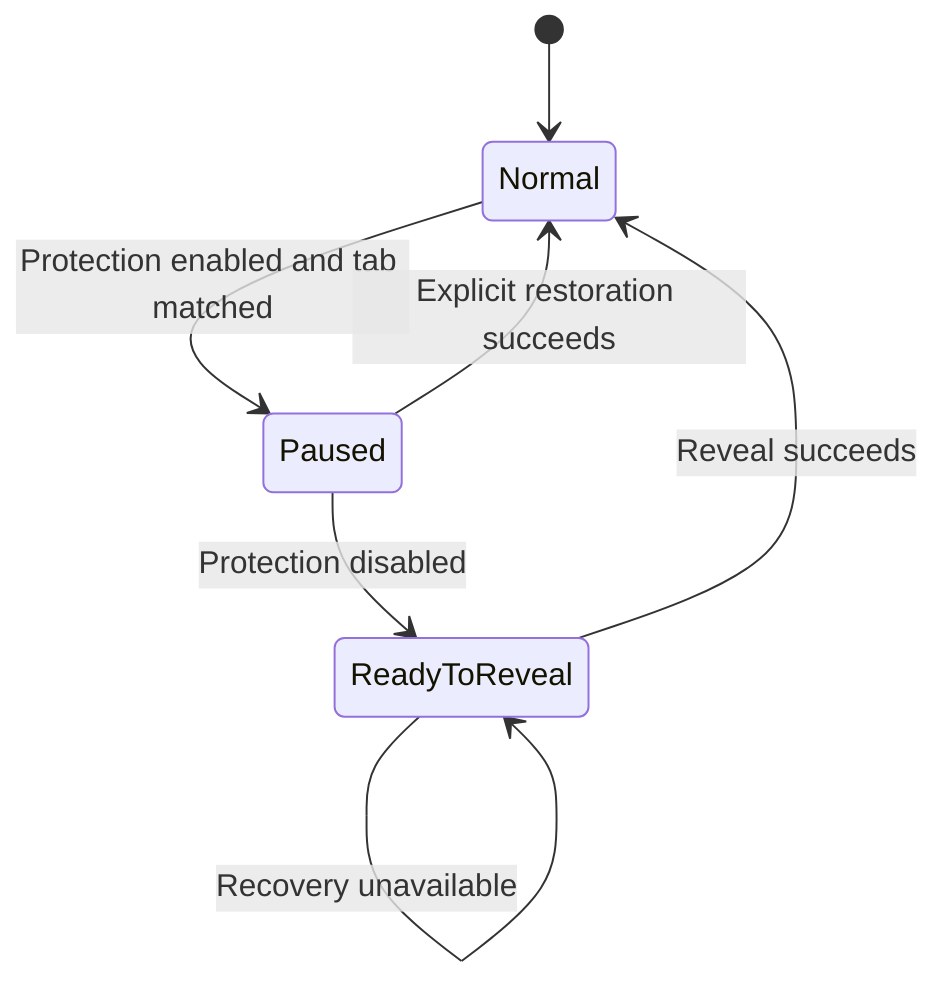
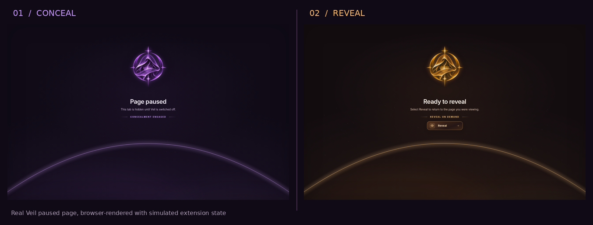
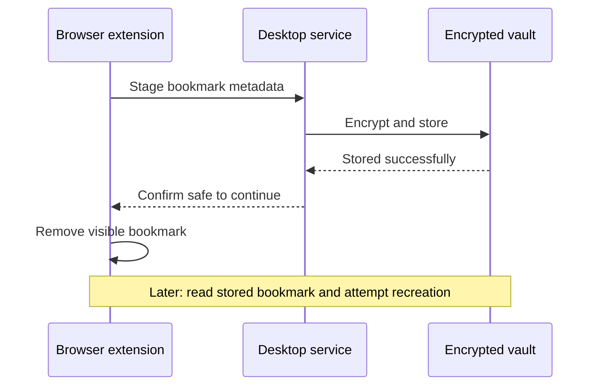

# Using Veil

[← Back to Veil](../README.md) · [Quick start](GETTING_STARTED.md) · [Illustrated tray menu](TRAY_MENU.md) · [CLI reference](CLI.md) · [Recovery](RECOVERY.md)

Veil controls browser visibility in a reversible way. The browser extension handles the tab UI; the local desktop service handles state, classification, and encrypted restoration data. Those responsibilities matter when something goes wrong.

## Protection controls

| Action | CLI | Behavior |
| --- | --- | --- |
| Launch the tray/service | `veil tray` | Starts the desktop interface and its service |
| Inspect state | `veil status` | Reports whether the daemon responds and whether protection is active |
| Change state | `veil toggle` | Asks the running daemon to toggle; refuses to claim success without acknowledgement |
| Restore paused destinations | `veil reveal-all` | Requests restore-all from connected extensions |
| Emergency control | `veil panic` | Requests protection and supported cleanup |
| Window minimization | `veil boss-key` | Adds supported desktop minimization behavior |
| Set a timer | `veil timer 20` | Requests a twenty-minute timer while the service runs |
| Cancel a timer | `veil timer --cancel` | Cancels the active timer |

See the [illustrated tray guide](TRAY_MENU.md) for the violet/amber states, Preferences, Tools, and accurate explanations of Quit, Panic, and the Boss Key.

The tray is intended for routine use. The CLI exposes the same service operations for scripts and diagnostics. Hotkey and window-minimization behavior depend on the desktop environment and compositor.

### Understanding the two phases



<p align="center">
  
</p>

**Violet / paused** indicates the tab is displaying the local placeholder while protection remains active. **Amber / ready to reveal** offers an explicit return to a previously saved destination. The Reveal button requires a usable recovery record and a functioning extension message path.

## Restoring tabs

When protection is disabled, a paused tab may offer the **Reveal** action. It requests restoration of that specific tab using the extension's saved destination data. `veil reveal-all` asks connected extensions to restore remaining paused tabs.

A tab that was closed, moved, re-created, or modified during the protected period may not restore in exactly the original shape. The extension cannot guarantee restoration across every crash, browser API change, or profile/sync race.

> [!CAUTION]
> If a tab or bookmark does not restore, avoid rapid repeated toggles. Preserve the vault and any backup, then follow the [recovery checklist](RECOVERY.md).

## Customizing matching

The classifier combines contextual URL/title analysis with an included offline adult-domain index. Its categories cover multiple content classes that might be inappropriate or undesirable in certain shared-screen settings. False positives and false negatives are possible.

### Inspect before changing anything

```bash
veil test https://example.org
veil test https://research.example.org "Research paper"
veil rules --list
```

### Leave a domain visible

```bash
veil rules --add-white research.example.org
```

### Always match a domain

```bash
veil rules --add-black private.example.org
veil test https://private.example.org
```

### Remove an override

```bash
veil rules --remove private.example.org
```

Local overrides are not guarantees for every descendant page or redirect edge case. Check your real intended URLs using `veil test`, and validate behavior in a disposable profile before working with valuable bookmarks.

## Bookmarks and recovery

When Veil stages a matching bookmark, the extension submits its destination and placement metadata to the desktop service. The service stores an encrypted record; only after that storage is acknowledged should the extension proceed with removing the visible bookmark. Restoration recreates the bookmark through browser APIs.



The goal is reversibility, but exact bookmark IDs and folder placement depend on browser APIs. Other extensions, cloud bookmark sync, folder deletion, and concurrent edits can interfere. Export an independent browser bookmark backup before using Veil with important data.

### What the vault statistics mean

```bash
veil stats
```

Vault statistics describe the current local store and known records; they are not a live audit of all open tabs in every browser profile. Use `veil status` to distinguish actual running protection from a persisted configuration preference.

## Encrypted vault export

```bash
veil export ~/veil-backup.veilvault
```

The command prompts for a backup passphrase in interactive use. Keep the file and passphrase separately. Avoid typing the passphrase as a command argument, which can expose it in terminal history and process inspection. [Full recovery guide →](RECOVERY.md)

## Clipboard, caches, and desktop utilities

`veil sanitize` operates on supported clipboard content. `veil shred` targets a limited set of browser temporary files; despite the name, it is **not** a disk-wide secure erase and does not generally clear browser history. `veil sound --enable` and `veil autostart --enable` manage optional desktop preferences.

## Performance and large sessions

Browser-side operations can be batched so handling many matching tabs doesn't incur a separate native message for every operation. That reduces IPC overhead. Actual performance still includes browser tab navigation, rendering, disk scheduling, concurrent scripts, and other processes.

The JavaScript scale tests simulate 100, 250, and 1,000-tab conditions; measured simulation timings should not be interpreted as promises about physical browsers on every Linux desktop.

## Useful next steps

[Command reference](CLI.md) · [Browser setup](BROWSER_SETUP.md) · [Privacy limitations](PRIVACY.md) · [Troubleshooting](TROUBLESHOOTING.md)
